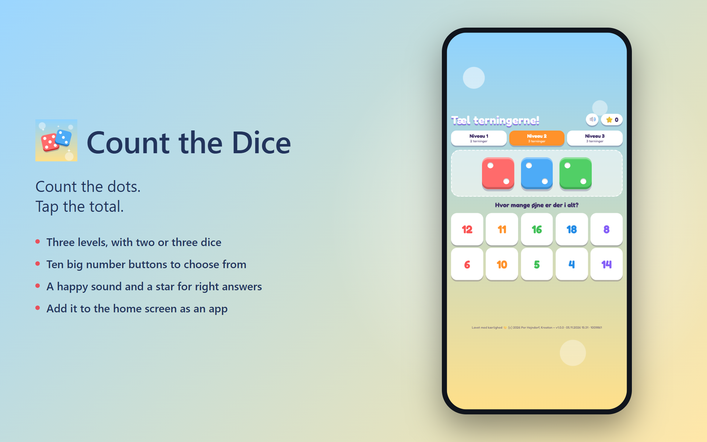

# Count the Dice


[](LICENSE)
[](https://github.com/kreaton/CountTheDice/stargazers)

⭐ If Count the Dice earns a place on your machine, [star it on GitHub](https://github.com/kreaton/CountTheDice) — it's free, made by one developer, and stars are how other people find it.



**A small counting game for young children.**

The game rolls a few dice, and the child counts the dots and taps the matching total among ten number buttons. A right answer gets a happy sound and a star. A wrong answer gets a gentle "Prøv igen!" (try again), and that button is greyed out.

It is a Blazor WebAssembly app (.NET 10) that runs entirely in the browser, with no server-side code. It works on phones and tablets and can be added to the home screen as an app (PWA manifest and Apple touch icons included).

## Levels

| Level | Dice | Answer choices range |
|-------|------|----------------------|
| 1     | 2    | 2–12                 |
| 2     | 3    | 2–18                 |
| 3     | 3    | 2–24                 |

Each round shows 10 choices: the correct sum plus 9 random wrong numbers from the level's range. Tap the dice tray (or "Slå igen!") to roll new dice.

## Running locally

```bash
dotnet run --project src/CountTheDice
```

The app is served under the `/countthedice` path, so open http://localhost:5012/countthedice (the `http` launch profile opens it for you).

## Publishing

Publish with:

```bash
dotnet publish src/CountTheDice -c Release -o src/CountTheDice/bin/Publish
```

Copy the contents of `bin/Publish/wwwroot` to the web server under `/countthedice/`. To host it at a different path, change `<base href="/countthedice/" />` in `wwwroot/index.html` and `--pathbase` in `Properties/launchSettings.json`.

## Project layout

```
src/CountTheDice/
  Game/DiceGame.cs        Game logic: levels, dice rolls, answer choices
  Pages/Home.razor        The game screen: dice tray, choices, feedback, stars
  Shared/Die.razor        One die face drawn with CSS pips
  wwwroot/js/sounds.js    Synthesized sounds (Web Audio, no audio files) and mute setting
  wwwroot/css/app.css     Styles and dice animation
  wwwroot/manifest.webmanifest, icons/   Home-screen app support
```

## Notes

- Sounds are generated with the Web Audio API, so there are no audio files. The mute button's setting is saved in the browser's `localStorage`.
- The star count is kept only for the current session and resets when the page reloads.

## License & Authorship

This project is distributed under the terms of the [MIT License](LICENSE).

**AI authorship note:** Most of the source code in this repository was generated with AI coding agents (Claude Code), under my direction and review. Purely AI-generated material may not be eligible for copyright protection in some jurisdictions. To the extent any part of this project is protected by copyright, it is licensed under the MIT License, and the license's warranty and liability disclaimers apply to the project as a whole.

<!-- notices:start -->
### Independent development

CountTheDice is an independent, personal project developed by Per Hejndorf. It is not affiliated with, endorsed by or sponsored by Microsoft or any other rights holder (including Google). Product names and logos are trademarks of their respective owners and are used only to identify the services and tools the project works with.

### Third-party notices and asset provenance

[THIRD-PARTY-NOTICES.md](THIRD-PARTY-NOTICES.md) lists every third-party library, font and online service the project uses, with version, licence, source and whether it was modified. It also records where the icons, images, audio and video came from and how they are licensed.
<!-- notices:end -->
